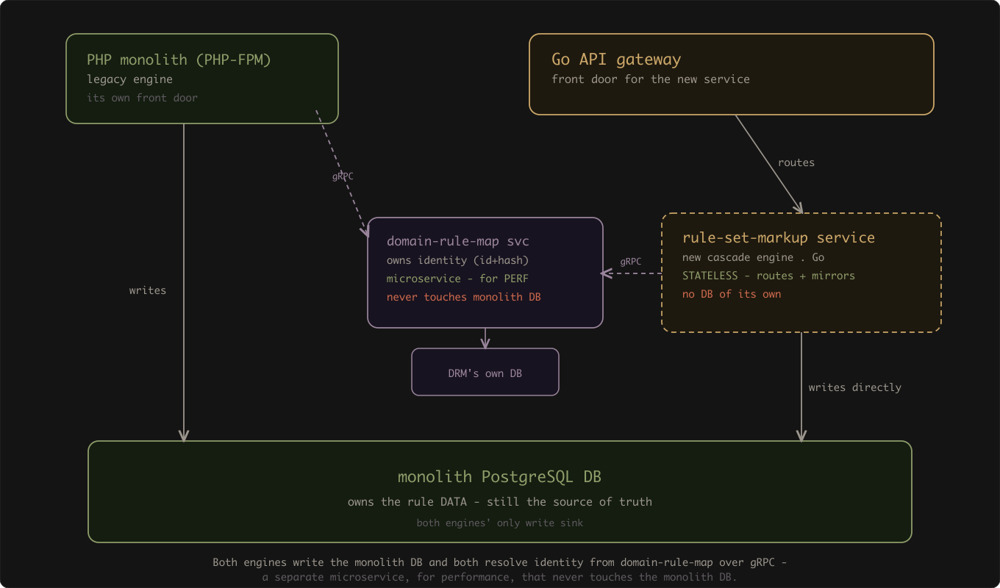
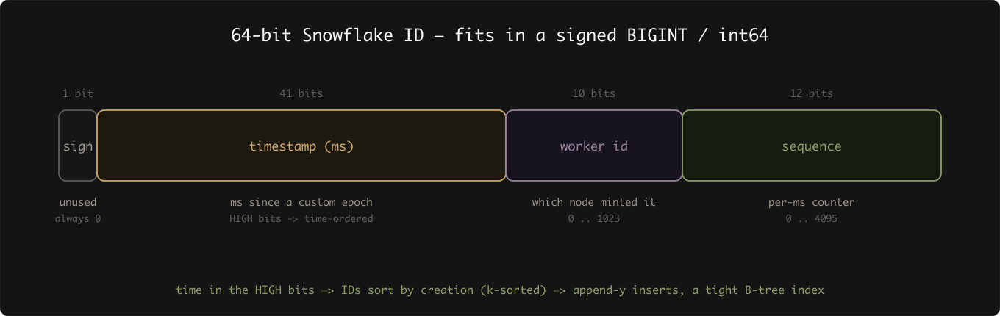
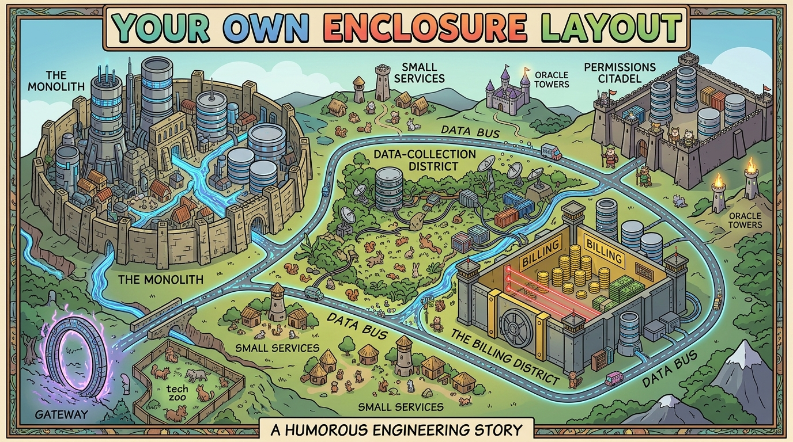
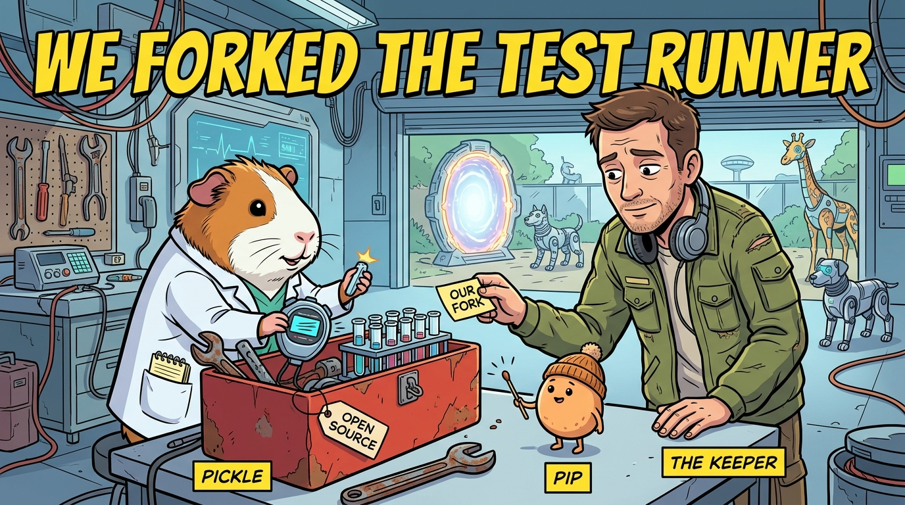
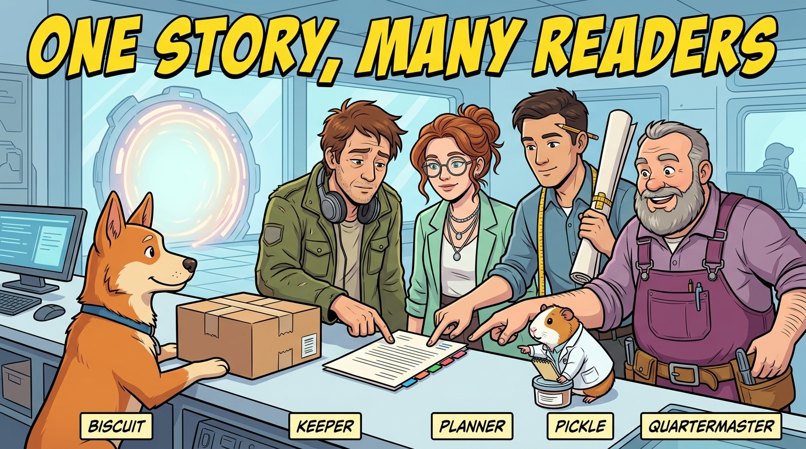
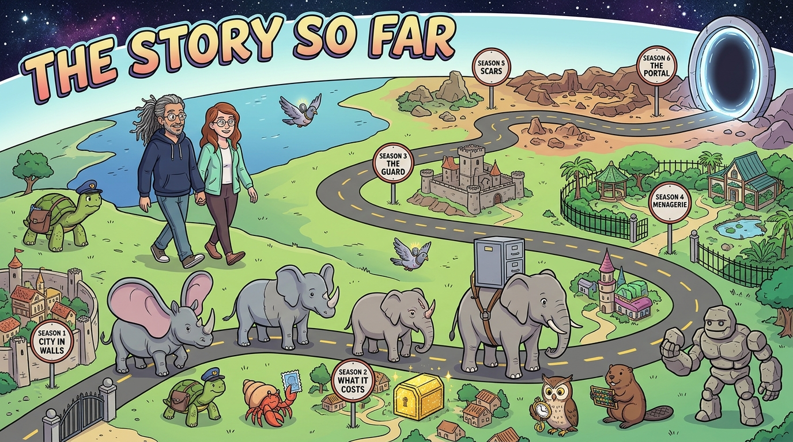
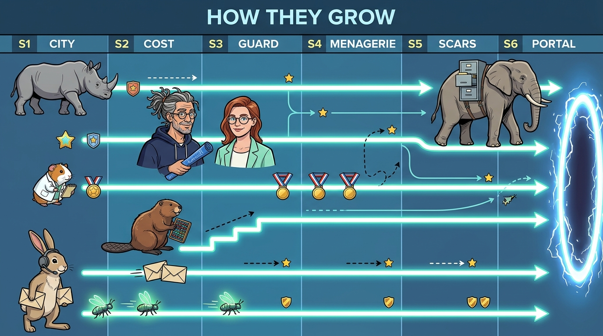

# Anton Brilliantov

**Distributed Systems Architect · Engineering Leader · Ex-CTO & Co-founder (SaaS)**
I design distributed systems and build the teams that run them.

📍 Ramat Gan, Israel · Open to architecture, platform, data-platform and engineering leadership roles
✉️ brilliantov.anton@gmail.com · 💼 [LinkedIn](https://www.linkedin.com/in/anton-brilliantov) · ✍️ [dev.to](https://dev.to/anton_brilliantov)

---

## In short

- **Built SEOWORK from the first line of code to my exit in 2021** as technical co-founder and CTO: collection scaled 40x to 1.3M+ queries/day per search engine, engineering grew from 1 to 10, enterprise clients included Ozon and M.Video. The platform still runs today.
- **Now:** founding engineer and platform architect of an early-stage startup in stealth. ~20 Go services and 100+ production components in under a year, with two engineers.
- **Data is the thread:** from board-level reporting, to high-volume collection pipelines, to a BigQuery redesign that cut a client's bill by up to 10x.

---

## What I'm building now

An early-stage startup in stealth. A well-structured Symfony monolith is being replaced service by service, for resource efficiency and independent scaling.

- **Go platform library** every service imports: lifecycle, gRPC/HTTP/Postgres/NATS/RabbitMQ/Redis, transactional outbox, Snowflake IDs, observability, testcontainers harness. New service to production in a day.
- **~20 microservices in production** across 35+ repositories, each shipping as gRPC server, worker, outbox and scheduler binaries. I design, build, deploy and operate them.
- **Analytical data layer**: ingestion and transformation pipelines from crawled and third-party sources.
- **Control plane**: service registry with mutual Ed25519 auth; admin with RBAC and audit trail.
- **Contracts as artefacts**: shared Protocol Buffers repo generating Go and PHP stubs.
- **Delivery**: CI/CD across 35+ repositories, 90% coverage gates, integration tests on real infrastructure, image-size budgets on every PR.

| Measured | Before | After |
|---|---|---|
| Memory per worker | ~150 MB (Symfony) | ~20 MB (Go), ~7x |
| Container image | 100+ MB | 20–30 MB, 5–10x |
| Metrics scrape | 50–200 ms | sub-millisecond |
| New service to prod | ~1 week | 1 day |

### Deep dives

| Document | What it covers |
|---|---|
| [architecture.md](docs/architecture.md) | System map, layers, outbox → NATS |
| [platform.md](docs/platform.md) | Go library, registry, service template |
| [migration.md](docs/migration.md) | PHP → Go: reasoning, method, measured savings |
| [admin-operations.md](docs/admin-operations.md) | Control plane: RBAC, audit, operations workflows |
| [ai-engineering.md](docs/ai-engineering.md) | How a two-person team ships safely with AI agents |
| [quality-standards.md](docs/quality-standards.md) | The enforced rule-book |

---

## Career

**Founding Engineer & Platform Architect** · Stealth Startup · Remote · Dec 2025 – present
Architecture, platform, delivery and technical roadmap.

**Data Architect & BigQuery Consultant** · Analyzit · Sep 2023 – Dec 2025
Up to 10x lower BigQuery bill; client onboarding from 1–2 hours to 15 minutes; designed and built the Data-Masters dashboard suite from scratch.

**Senior Backend Engineer / Team Lead** · Lenvendo · Nov 2021 – Aug 2023
Modular e-commerce core over Kafka and RabbitMQ; led a team of up to 6.

**SEOWORK — one company, three stages, eight years** · 2013 – 2021
- **Co-founder & CTO** · 2018 – 2021 · standalone company, organic growth · exited 2021
- **Head of Development** · 2015 – 2018 · inside 404 Group, venture-backed
- **Backend Developer** · 2013 – 2015 · in-house platform at the Webit agency; clients were billed on its data

Grew engineering 1 → 10. Scaled collection 40x without a big-bang rewrite; terabytes of data in MySQL, sharded by logical tables. Built the full pipeline: ingestion, deduplication, normalisation, classification, scoring, aggregates, retention. European Search Awards finalist 2021. Owned pricing and roadmap with the CEO.

**Support → Network Engineer → Developer** · NETBYNET · 2005 – 2013
Eight years, six roles, ending in the corporate reporting the board relied on.

---

## Open source

- [**metrics-bridge-rs**](https://github.com/brilliant-almazov/metrics-bridge-rs) · Prometheus exporter for PHP metrics in Redis. Sub-millisecond vs 50–200 ms through PHP, 12,500+ RPS.
- [**pgenum**](https://github.com/brilliant-almazov/pgenum) · Go · Runtime management of PostgreSQL ENUM types, zero dependencies.
- [**railway-exporter-rs**](https://github.com/brilliant-almazov/railway-exporter-rs) · Prometheus exporter for Railway.app billing.

---

## Writing

Everything is on [dev.to](https://dev.to/anton_brilliantov): one platform, many services, told through real decisions, measured results and a small cast of zoo characters.

### Published

**Breaking the Monolith** · migration strategy, service boundaries, zero-downtime cutover, and testing two systems that must agree while one replaces the other.

| Part | Article |
|---|---|
| 1 | [A 200 OK that saved nothing](https://dev.to/anton_brilliantov/breaking-the-monolith-part-1-a-200-ok-that-saved-nothing-16ef) |
| 2 | [Who owns a hash function](https://dev.to/anton_brilliantov/breaking-the-monolith-part-2-who-owns-a-hash-function-4h3f) |
| 3 | [The cascade that timed out](https://dev.to/anton_brilliantov/breaking-the-monolith-part-3-the-cascade-that-timed-out-43pa) |
| 4 | [Flipping the master live](https://dev.to/anton_brilliantov/breaking-the-monolith-part-4-flipping-the-master-live-2kn9) |
| 6 | [Most "we need a saga" is really "we need idempotency"](https://dev.to/anton_brilliantov/breaking-the-monolith-part-6-most-we-need-a-saga-is-really-we-need-idempotency-2894) |
| 15 | [Two rule engines, one truth](https://dev.to/anton_brilliantov/breaking-the-monolith-part-15-two-rule-engines-one-truth-4mhb) |

**Snowflake IDs** · [Why int8 Snowflake and never UUID](https://dev.to/anton_brilliantov/snowflake-ids-part-1-why-int8-snowflake-and-never-uuid-1nb8)

### Coming next

A planet of settlements: every service is a settlement, the monolith is a walled city, billing is a gold vault, permissions is a citadel, the gateway is a ring portal and the message bus is the road between them. A keeper writes the plan; settlements are printed from it.

| Series | What it is about |
|---|---|
| **Zoo keeping, built in** | what a platform gives every service for free: archives, migrations, connections, settings, every door that must open, your own layout |
| **Cheap hypotheses for acceptance** | we forked an open-source test runner: declarative scenarios only, a run that writes its own report, only real problems in the problems file |
| **A PR body for every role** | one pull request, many readers: the service, the architecture, the platform, acceptance and the articles each get their own form |
| **Cutting the monolith small** | the walled city shrinks, villages grow, and the database slowly turns from a rhino into an elephant |

### The story so far

Six seasons ahead, one character arc per resident: the database grows from a rhino into an elephant, acceptance collects medals, billing climbs levels, bugs leave a mechanism behind every scar.

---

## Engineering principles

- One way to do everything, enforced by the platform library.
- 90% coverage floor in CI; floors only go up.
- Integration tests on real Postgres, NATS and RabbitMQ. Never mocks for infrastructure.
- Schema-first contracts: shared protos, forward-only migrations.
- Zero defaults in shared libraries: a missing config fails at start, not in production.
- AI executes; architecture decisions stay human.
- No standing production access for agents: granted deliberately, per task, only when needed. Critical operations stay hands-on.

---

**Languages:** English (professional), Russian (native), Hebrew (learning).
